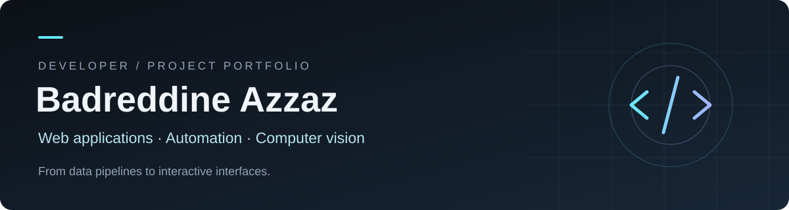

<a href="#selected-work">Selected work</a> · <a href="#tools-in-my-projects">Tech stack</a> · <a href="mailto:badrazzaz03@gmail.com">Contact</a>

I build web applications and explore how software connects data with interactive interfaces. My public work ranges from a job-search dashboard with a Python API and React frontend to webcam interaction experiments and marker-based augmented reality.

My latest public project is **[JobScraper Dashboard](https://github.com/badredddineazzaz/jobScrapingDashboard)**: collecting job offers, following search progress and managing applications in one place.

## Selected work

<table>
<tr>
<td width="50%" valign="top">
<h3><a href="https://github.com/badredddineazzaz/jobScrapingDashboard">JobScraper Dashboard ↗</a></h3>

Job aggregation and application tracking. A modular backend with SQL persistence, background searches, live progress events and a React dashboard.

Python · FastAPI · React · TypeScript · SQLAlchemy · Docker

</td>
<td width="50%" valign="top">
<h3><a href="https://github.com/badredddineazzaz/ARUCO-AR-3d">ArUco Augmented Reality ↗</a></h3>

A 3D lung model rendered over a live camera feed using marker pose estimation, OpenGL and camera projection transforms.

Python · OpenCV · ArUco · OpenGL · NumPy

</td>
</tr>
<tr>
<td width="50%" valign="top">
<h3><a href="https://github.com/badredddineazzaz/IHM-Projects">Vision-Based Interaction ↗</a></h3>

C++ experiments in webcam object tracking, cursor control, hand detection and image browsing. Coursework exploring human–computer interaction.

C++ · OpenCV · Windows API

</td>
<td width="50%" valign="top">
<h3><a href="https://github.com/badredddineazzaz/functionnal-java">Recipe XML Explorer ↗</a></h3>

A collaborative Java coursework project: parse recipe XML, query ingredients and nutrition, and explore results through a JavaFX interface.

Java · JavaFX · XML DOM · Maven

</td>
</tr>
</table>

## Tools in my projects

Also represented in my earlier projects: **PHP, MySQL, JavaScript, HTML and CSS**.

More projects &amp; foundations

- [Seven-segment decoder](https://github.com/badredddineazzaz/7segmentscpp) — hexadecimal input, Boolean logic and terminal rendering in C++.
- [ESTCOURS](https://github.com/badredddineazzaz/Java-projects) — collaborative Java/MySQL coursework with console and JavaFX interfaces.
- [Articles website](https://github.com/badredddineazzaz/articles_website) — PHP/MySQL publishing prototype.
- [Frontend experiments](https://github.com/badredddineazzaz/Html-Css-JavaScript) — weather interface and digital clock.
- [MyGym](https://github.com/badredddineazzaz/WEB-Projects) — collaborative PHP web coursework.

---

Interested in a project or collaboration? **[Get in touch](mailto:badrazzaz03@gmail.com)** or open an issue in the relevant repository.
